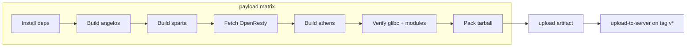

# DDoS Firewall

A high-performance, multi-layered DDoS protection system combining eBPF/XDP-based L4 firewall with OpenResty-based L7 protection, managed through a comprehensive REST API.

**Components:** angelos (API) · sparta (L4 eBPF) · athens (L7 OpenResty)  
**CI:** GitHub Actions builds OS-specific payloads on every push/PR; tag `v*` releases deploy to `/opt/dorian/uploads/`  
**Version:** see [`VERSION`](VERSION) (tag builds use the tag name, e.g. `v0.2.7` → `0.2.7`)

## Table of Contents

- [Overview](#overview)
- [Features](#features)
- [Architecture](#architecture)
- [CI/CD (GitHub Actions)](#cicd-github-actions)
- [Build Process](#build-process)
- [Requirements](#requirements)
- [Installation](#installation)
- [Configuration](#configuration)
- [API Documentation](#api-documentation)
- [Usage Examples](#usage-examples)
- [Service Management](#service-management)
- [Troubleshooting](#troubleshooting)
- [Development](#development)
- [Contributing](#contributing)
- [License](#license)

## Overview

DDoS Firewall is a comprehensive network security solution that provides protection against Distributed Denial of Service (DDoS) attacks at both Layer 4 (L4) and Layer 7 (L7) of the OSI model.

### Key Components

The product ships as three coordinated payloads:

| Codename | Directory | Role |
|----------|-----------|------|
| **angelos** | `api_parser/` | REST API (Flask/Gunicorn) for L4/L7 management |
| **sparta** | `ebpf_firewall/` | L4 eBPF/XDP packet filter |
| **athens** | `openresty-modules/` | L7 OpenResty reverse proxy, ACL, cache, and stats |

Supporting infrastructure:

- **Redis** (`/tmp/redis.sock`) — ACL rules, upstreams, cache rules, cache purge index, temporary blacklist
- **SQLite** — blocklists, whitelists, and firewall state

### How It Works

- **L4 (sparta)**: eBPF programs intercept packets at the XDP layer before they reach the kernel network stack
- **L7 (athens)**: OpenResty with custom C/Lua modules handles HTTP/HTTPS traffic, ACL, dynamic caching, and statistics
- **API (angelos)**: REST API writes configuration to Redis/SQLite and controls both layers
- **Centralized management**: Dynamic rules via Redis pub/sub; hot reload without full restarts where possible

## Features

### L4 Firewall Features

- **Multi-Vector Attack Protection**:
  - TCP SYN flood protection
  - TCP ACK flood protection
  - TCP RST flood protection
  - ICMP flood protection
  - UDP flood protection
  - GRE flood protection

- **Intelligent Detection**:
  - Rate limiting with configurable thresholds
  - Burst detection (packets per burst, burst frequency)
  - Fixed window threshold monitoring
  - Challenge-response mechanism for SYN floods

- **Automatic IP Blocking**:
  - Temporary blocking of malicious IPs
  - Configurable block duration
  - Manual IP management (add/remove)

- **Performance**:
  - Kernel-level processing (XDP)
  - Minimal CPU overhead
  - High packet processing rates

### L7 Firewall Features (athens)

- **HTTP/HTTPS protection**: ACL, geo filtering, rate limits, user-agent rules, temporary blacklist
- **Dynamic configuration via Redis**: ACL rules, upstream servers, cache rules loaded from Redis keys
- **Proxy cache with slice support**: Range-based caching for large files (`ngx_slice` + patched nginx slice module)
- **Selective cache purge**: Redis-indexed purge module (`ngx_purge`) with Lua sync on key expiration
- **Statistics API**: Per-IP, URL, country, ISP, referer, and traffic metrics on port 9000
- **Custom OpenResty modules**: `ngx_acl`, `ngx_lic`, `ngx_slice`, `ngx_purge`

### API Features (angelos)

- **RESTful API**: Complete HTTP API for all operations
- **Token-based Authentication**: Secure API access
- **Real-time Configuration**: Dynamic rule updates
- **Health Monitoring**: Service status and health checks
- **Database Management**: Blocklist/whitelist storage and querying

## Architecture

```
┌──────────────────────────────────────────────────────────────────┐
│                     angelos (REST API)                            │
│                  api_parser/ → port 5000                          │
│   Routes: L4, L7, stats  │  Redis client  │  SQLite (blocklists) │
└────────────────────────────┬─────────────────────────────────────┘
                             │ Redis (/tmp/redis.sock)
              ┌──────────────┴──────────────┐
              │                             │
┌─────────────▼─────────────┐   ┌───────────▼──────────────────────┐
│  sparta (L4 eBPF/XDP)     │   │  athens (L7 OpenResty)           │
│  ebpf_firewall/           │   │  /usr/local/share/dorian/athens  │
│  XDP hooks, flood detect  │   │  ACL · cache · purge · stats     │
└───────────────────────────┘   └──────────────────────────────────┘
```

### Runtime paths (athens)

| Path | Purpose |
|------|---------|
| `/usr/local/share/dorian/athens/nginx/sbin/nginx` | OpenResty binary |
| `/usr/local/share/dorian/athens/nginx/conf/athens.conf` | Main config |
| `/usr/local/share/dorian/athens/nginx/lua/resty/` | Lua modules |
| `/usr/local/share/dorian/athens/nginx/cache/athens/` | Proxy cache files |
| `/tmp/redis.sock` | Redis (db 0 = config, db 2 = cache purge index) |

### Directory Structure

```
ddos-firewall/
├── .github/
│   ├── workflows/build-payload.yml   # CI: build angelos + sparta + athens
│   └── scripts/install-libxdp-dev.sh
├── api_parser/                       # angelos — REST API source
├── ebpf_firewall/                    # sparta — L4 eBPF firewall
├── openresty-modules/                # athens — L7 OpenResty build
│   ├── config/                       # nginx conf + Lua (resty/*.lua)
│   ├── ngx_acl/                      # ACL C module
│   ├── ngx_lic/                      # License module
│   ├── ngx_slice/                    # Dynamic slice FFI module
│   ├── ngx_purge/                    # Redis-indexed cache purge module
│   ├── libmaxminddb/                 # GeoIP library
│   └── script.sh                     # Athens build script
├── setup/
│   ├── pack.sh                       # Legacy local packager
│   ├── installer_stub.sh             # Self-extracting installer
│   └── payload/                      # CI output: angelos, sparta, athens
├── redis-socket.conf                 # Local Redis config (unix socket)
└── VERSION                           # Product version file
```

## CI/CD (GitHub Actions)

Workflow file: [`.github/workflows/build-payload.yml`](.github/workflows/build-payload.yml)

### Triggers

| Event | Behavior |
|-------|----------|
| Push to `main` / `master` | Build payload for Ubuntu 22.04 and 24.04; upload artifacts |
| Pull request | Same build (no deploy) |
| Tag push `v*` | Build + upload artifacts + SCP to deploy server |

### Matrix

Builds run on **ubuntu-22.04** and **ubuntu-24.04** runners independently. Each produces an OS-specific tarball:

```
dorian-ddos-firewall-<version>-<os_slug>-payload.tar.gz
```

Example: `dorian-ddos-firewall-0.2.7-ubuntu-22.04-payload.tar.gz`

The archive contains `BUILD_INFO` with `os_slug`, `glibc`, git SHA, and build timestamp — **install the tarball matching your target OS**.

### Workflow jobs



**Job `payload`** (per OS):

1. Install build dependencies (including `libev-dev`, `libhiredis-dev`, `libpcre2-dev`)
2. Install libxdp (apt on 24.04, source build on 22.04)
3. **Build angelos** — `api_parser/build.sh` (Cython `.so` compilation)
4. **Build sparta** — `ebpf_firewall/script.sh`
5. **Fetch OpenResty** 1.27.1.2 source
6. **Prepare deps** — uthash, cJSON, libmaxminddb
7. **Build athens** — `openresty-modules/script.sh`
8. **Verify** — nginx prefix, GLIBC linkage, purge/slice modules present
9. **Pack** — tarball to `setup/payload/`

**Job `upload-to-server`** (tags only):

- Requires secrets: `DEPLOY_HOST`, `DEPLOY_USER`, `DEPLOY_SSH_PRIVATE_KEY`, `DEPLOY_SSH_PORT`
- Optional: `DEPLOY_OS_SLUG` — limit upload to one OS variant
- Uploads to `/opt/dorian/uploads/` on the deploy server

### Required GitHub secrets (tag deploy)

| Secret | Purpose |
|--------|---------|
| `DEPLOY_HOST` | Target server hostname |
| `DEPLOY_USER` | SSH user |
| `DEPLOY_SSH_PRIVATE_KEY` | SSH private key |
| `DEPLOY_SSH_PORT` | SSH port |

## Build Process

### Athens (OpenResty) build steps

`openresty-modules/script.sh` performs:

1. **Patch nginx bundle** (`bundle/nginx-1.27.1/`):
   - `ngx_purge/ngx_http_file_cache-1.27.1.patch`
   - `ngx_purge/ngx_http_upstream-1.27.1.patch`
   - `ngx_slice/ngx_http_slice_filter_module.patch`
2. **OpenResty `./configure`** with modules: `ngx_acl`, `ngx_lic`, `ngx_slice`, `ngx_purge`, `--with-http_slice_module`
3. **Build `redis_nginx_adapter`** against `build/nginx-1.27.1/` (requires configure-generated headers)
4. **`make && make install`** — prefix `/usr/local/share/dorian/athens`
5. **Copy configs and Lua** into payload staging directory

### Local build (full payload)

```bash
# From repository root — requires root/sudo for some install paths

# 1. System dependencies
sudo apt-get update
sudo apt-get install -y \
  build-essential clang llvm curl git cmake pkg-config \
  libbpf-dev libnetfilter-conntrack-dev libsqlite3-dev libssl-dev \
  libmicrohttpd-dev libpcre3-dev libpcre2-dev zlib1g-dev \
  libev-dev libhiredis-dev flex bison libcurl4-openssl-dev \
  libsodium-dev python3 python3-venv python3-dev

# 2. Build angelos
export DDOS_FW_CI_PAYLOAD_ONLY=1
bash api_parser/build.sh

# 3. Build sparta
bash ebpf_firewall/script.sh

# 4. Fetch OpenResty and build athens
cd openresty-modules
curl -fsSL https://openresty.org/download/openresty-1.27.1.2.tar.gz -o /tmp/openresty.tgz
tar xzf /tmp/openresty.tgz -C .
bash script.sh
```

Output lands in `setup/payload/{angelos,sparta,athens}/`.

### Payload contents

Each tarball includes:

| Directory | Contents |
|-----------|----------|
| `angelos/` | Compiled API `.so` files, Python app, systemd unit |
| `sparta/` | eBPF binaries, config templates, systemd unit |
| `athens/` | OpenResty/nginx binary, configs, Lua modules, luajit libs |
| `VERSION` | Product version string |
| `BUILD_INFO` | `os_slug`, glibc version, git SHA, build timestamp |

### Athens-only rebuild

```bash
cd openresty-modules
sudo apt-get install -y libev-dev libhiredis-dev
bash script.sh
sudo systemctl reload athens   # if installed
```

### CI vs local environment variables

| Variable | CI value | Purpose |
|----------|----------|---------|
| `DDOS_FW_CI_PAYLOAD_ONLY` | `1` | Stage into `setup/payload/` without system install |
| `LIB_UTHASH` | `.ci-deps/uthash` | uthash headers for ngx_acl |
| `LIB_MAXMINDDB` | `.ci-deps/libmaxminddb` | GeoIP library |
| `LIB_REDIS_ADAPTER` | `.ci-deps/redis-adapter` | redis_nginx_adapter install prefix |
| `OPENRESTY_VER` | `1.27.1.2` | Set in workflow env |

## Requirements

### System Requirements

- **OS**: Linux (Ubuntu 22.04 / 24.04 tested in CI; Ubuntu 20.04+, Debian 11+, or similar)
- **Kernel**: 5.10+ (for XDP support)
- **Architecture**: x86_64

### Software Dependencies

- **Python**: 3.8+ (3.10 recommended)
- **GCC/Clang**: For compiling eBPF programs
- **LLVM**: 10+ for eBPF compilation
- **OpenResty**: 1.27.1.2 (athens)
- **Redis**: Required (unix socket `/tmp/redis.sock`; see `redis-socket.conf`)
- **SQLite**: 3.x

### Build Dependencies

```bash
apt-get update
apt-get install -y \
    python3 python3-venv python3-dev \
    gcc clang llvm libelf-dev libbpf-dev \
    xdp-tools libnetfilter-conntrack-dev \
    build-essential curl wget git cmake pkg-config \
    libpcre3-dev libpcre2-dev zlib1g-dev \
    libev-dev libhiredis-dev \
    libssl-dev libmicrohttpd-dev libsodium-dev \
    flex bison libcurl4-openssl-dev
```

Additional libraries built by `openresty-modules/script.sh`:

- **uthash** — hash tables for ngx_acl
- **cJSON** — JSON parsing in ngx_acl
- **libmaxminddb** — GeoIP lookups
- **redis_nginx_adapter** — async Redis for ngx_purge ([wandenberg/redis_nginx_adapter](https://github.com/wandenberg/redis_nginx_adapter))

## Installation

### From CI artifact (recommended)

1. Download the tarball matching your OS from GitHub Actions artifacts or `/opt/dorian/uploads/`:
   ```
   dorian-ddos-firewall-<version>-ubuntu-22.04-payload.tar.gz
   ```
2. Extract and inspect `BUILD_INFO` inside the archive.
3. Run the installer stub (see `setup/installer_stub.sh` for deployment steps).

### Legacy local packager

```bash
cd setup
./pack.sh          # builds angelos .so files + creates setup.sh installer
sudo ./setup.sh    # on target host
```

### Installation layout

| Component | Install path |
|-----------|--------------|
| angelos | `/usr/local/share/api_parser/` (service: `angelos.service`) |
| sparta | `/usr/local/bin/` (service: `sparta.service`) |
| athens | `/usr/local/share/dorian/athens/` (service: `athens.service`) |
| Redis config | `/etc/redis/redis-socket.conf` |

### Installation Process

The installer performs the following steps:

1. **Extract payload** → Files extracted to temporary directory
2. **Copy binaries** → L4/L7 firewall binaries copied to `/usr/local/bin/`
3. **Install API parser** → Python modules installed to `/usr/local/share/api_parser/`
4. **Create Python venv** → Virtual environment created
5. **Install dependencies** → Packages from `requirements.txt` installed
6. **Compile .so files** → Python modules compiled to `.so` files (code protection)
7. **Install systemd services** → Services installed and enabled
8. **Start services** → Services started automatically

### Post-Installation

After installation, verify services are running:

```bash
# Angelos (API)
sudo systemctl status angelos
sudo journalctl -u angelos -f

# Sparta (L4)
sudo systemctl status sparta

# Athens (L7)
sudo systemctl status athens
sudo /usr/local/share/dorian/athens/nginx/sbin/nginx -t

# Verify angelos .so files were compiled
find /usr/local/share/api_parser -name "*.so"
```

## Configuration

### API Parser Configuration

Edit `/usr/local/share/api_parser/config.py`:

```python
# Server configuration
SERVER_IP = "0.0.0.0"
SERVER_PORT = 5000

# API URLs (backend endpoints)
API_BASE_URL = "https://your-backend.com/api/endpoint"

# Database path
FIREWALL_DB_NAME = "/usr/local/share/dorian/sparta/firewall_control.db"
```

### L4 Firewall Configuration

Edit `/usr/local/share/dorian/sparta/firewall.config`:

```ini
#------------------GLOBAL-------------------
dev = eth0                    # Network interface
attach_mode = native         # XDP mode: skb, native, drv, hw
black_ip_duration = 3600     # Block duration (seconds)

#------------------SYN-----------------------
syn_threshold = 200000       # Packets per second
syn_burst_pkt = 20           # Packets per burst
syn_burst_count_per_sec = 10 # Burst frequency
syn_fixed_threshold = 2000   # Fixed window threshold
syn_fixed_check_duration = 15 # Window duration (seconds)
syn_challenge_timeout = 3    # Challenge timeout (seconds)

# Similar configs for ACK, RST, ICMP, UDP, GRE...
```

### L7 Firewall Configuration (athens)

Main config: `/usr/local/share/dorian/athens/nginx/conf/athens.conf`

Key includes:

| File | Purpose |
|------|---------|
| `http_lua_acl.conf` | ACL module, GeoIP database path |
| `http_purge_cache.conf` | Redis socket + db for cache purge index |
| `http_proxy_cache.conf` | Proxy cache zone (`athens_cache`) |
| `http_shared_dicts.conf` | Lua shared dicts (ACL cache, stats, purge sync) |
| `server_main_acl.conf` | Main protected server + Lua access phase |
| `server_stats_api.conf` | Stats and purge API on port 9000 |

**Redis** (`redis-socket.conf`):

- Unix socket: `/tmp/redis.sock`
- db 0 — ACL rules, upstreams, cache rules, temporary blacklist
- db 2 — cache purge index (key → cache file path)
- `notify-keyspace-events Exgh$` — required for cache purge sync and ACL keyevent fallback

Configuration is managed through the angelos API (see API Documentation).

## API Documentation

### Authentication

All API endpoints require token authentication via the `token` parameter in the request body:

```json
{
  "token": "your_authentication_token"
}
```

### Base URL

```
http://your-server:5000/API
```

### L4 Firewall Endpoints

#### Firewall Control

**POST** `/API/L4/firewall_main`

Start, stop, or restart the L4 firewall.

**Request:**
```json
{
  "token": "your_token",
  "status": "start|stop|restart",
  "interface": "eth0",
  "attach_mode": "native"
}
```

**Response:**
```json
{
  "status": "success",
  "action": "start",
  "message": "Firewall started successfully",
  "interface": "eth0",
  "attach_mode": "native",
  "blocklist_loaded": true,
  "blocklist_count": 150,
  "whitelist_loaded": true,
  "whitelist_count": 10
}
```

#### Protection Configuration

**POST** `/API/L4/tcp_syn`

Configure TCP SYN flood protection.

**Request:**
```json
{
  "token": "your_token",
  "status": "enable|disable",
  "threshold": 200000,
  "burst_pkt": 20,
  "burst_counter": 10,
  "fixed_threshold": 2000,
  "fixed_duration": 15,
  "challenge_timeout": 3,
  "protection_duration": 60
}
```

Similar endpoints:
- `/API/L4/tcp_ack` - TCP ACK protection
- `/API/L4/tcp_rst` - TCP RST protection
- `/API/L4/icmp` - ICMP protection
- `/API/L4/udp` - UDP protection
- `/API/L4/gre` - GRE protection

#### IP Management

**POST** `/API/L4/add_block_ip`

Add IP to blocklist.

**Request:**
```json
{
  "token": "your_token",
  "ip": "192.168.1.100",
  "duration": 3600
}
```

**POST** `/API/L4/remove_block_ip`

Remove IP from blocklist.

**Request:**
```json
{
  "token": "your_token",
  "ip": "192.168.1.100"
}
```

**POST** `/API/L4/remove_block_ip_all`

Remove all IPs from blocklist.

**POST** `/API/L4/add_white_ip`

Add IP to whitelist.

**POST** `/API/L4/remove_white_ip`

Remove IP from whitelist.

**POST** `/API/L4/get_blocklist`

Query blocklist with filters.

**Request:**
```json
{
  "token": "your_token",
  "filter_type": "SYN|ACK|RST|ICMP|UDP|GRE|x",
  "filter_ip": "192.168.1.100|x",
  "filter_date": "2025-11-20|x"
}
```

**Response:**
```json
{
  "status": "success",
  "data": [
    {
      "id": 1,
      "ip": "192.168.1.100",
      "type": "SYN",
      "duration": 3600,
      "reason": "Flood attack detected",
      "created": "2025-11-20 10:30:00",
      "timestamp": "2025-11-20 10:30:00"
    }
  ]
}
```

#### Advanced Features

**POST** `/API/L4/tcp_seg`

Enable/disable TCP segment checking.

**POST** `/API/L4/tcp_geo`

Configure geo-location filtering.

**POST** `/API/L4/tcp_con_limit`

Set TCP connection limit.

### L7 Firewall Endpoints

#### Firewall Control

**POST** `/API/L7/firewall_main`

Start, stop, or restart L7 firewall (OpenResty).

**Request:**
```json
{
  "token": "your_token",
  "status": "start|stop|restart"
}
```

#### Request Method Filtering

**POST** `/API/L7/allow_request_method`

Configure allowed HTTP methods.

**Request:**
```json
{
  "token": "your_token",
  "methods": ["GET", "POST", "PUT", "DELETE"]
}
```

**GET** `/API/L7/allow_request_method`

Get current allowed methods.

#### Backend Management

**POST** `/API/L7/backend_list`

Configure backend servers.

**Request:**
```json
{
  "token": "your_token",
  "backends": [
    {
      "name": "backend1",
      "ip": "192.168.1.10",
      "port": 8080,
      "weight": 100
    }
  ]
}
```

**GET** `/API/L7/backend_list`

Get current backend configuration.

#### ACL System

**POST** `/API/L7/acl_system_config`

Configure ACL system settings.

**POST** `/API/L7/set_acl`

Set ACL rules.

**POST** `/API/L7/acl_rule_management`

Manage ACL rules (add, update, delete).

**POST** `/API/L7/acl_rule_apply`

Apply ACL rules to Nginx configuration.

#### Port Configuration

**POST** `/API/L7/set_ports`

Configure listening ports.

**Request:**
```json
{
  "token": "your_token",
  "ports": [80, 443, 8080]
}
```

### Common Endpoints

**POST** `/API/common/health_check`

Health check endpoint.

**Request:**
```json
{
  "token": "your_token"
}
```

**Response:**
```json
{
  "status": "success",
  "message": "API parser is running",
  "timestamp": "2025-11-20T10:30:00"
}
```

**POST** `/API/common/get_config`

Get current configuration.

## Usage Examples

### Starting the Firewall

```bash
# Start L4 firewall
curl -X POST http://localhost:5000/API/L4/firewall_main \
  -H "Content-Type: application/json" \
  -d '{
    "token": "your_token",
    "status": "start",
    "interface": "eth0",
    "attach_mode": "native"
  }'

# Start L7 firewall
curl -X POST http://localhost:5000/API/L7/firewall_main \
  -H "Content-Type: application/json" \
  -d '{
    "token": "your_token",
    "status": "start"
  }'
```

### Configuring TCP SYN Protection

```bash
curl -X POST http://localhost:5000/API/L4/tcp_syn \
  -H "Content-Type: application/json" \
  -d '{
    "token": "your_token",
    "status": "enable",
    "threshold": 200000,
    "burst_pkt": 20,
    "burst_counter": 10,
    "fixed_threshold": 2000,
    "fixed_duration": 15,
    "challenge_timeout": 3,
    "protection_duration": 60
  }'
```

### Adding IP to Blocklist

```bash
curl -X POST http://localhost:5000/API/L4/add_block_ip \
  -H "Content-Type: application/json" \
  -d '{
    "token": "your_token",
    "ip": "192.168.1.100",
    "duration": 3600
  }'
```

### Querying Blocklist

```bash
curl -X POST http://localhost:5000/API/L4/get_blocklist \
  -H "Content-Type: application/json" \
  -d '{
    "token": "your_token",
    "filter_type": "SYN",
    "filter_ip": "x",
    "filter_date": "2025-11-20"
  }'
```

### Python Client Example

```python
import requests

API_BASE = "http://localhost:5000/API"
TOKEN = "your_token"

# Start firewall
response = requests.post(
    f"{API_BASE}/L4/firewall_main",
    json={
        "token": TOKEN,
        "status": "start",
        "interface": "eth0",
        "attach_mode": "native"
    }
)
print(response.json())

# Configure SYN protection
response = requests.post(
    f"{API_BASE}/L4/tcp_syn",
    json={
        "token": TOKEN,
        "status": "enable",
        "threshold": 200000,
        "burst_pkt": 20,
        "burst_counter": 10,
        "fixed_threshold": 2000,
        "fixed_duration": 15,
        "challenge_timeout": 3,
        "protection_duration": 60
    }
)
print(response.json())
```

## Service Management

### Systemd Services

| Service | Component | Description |
|---------|-----------|-------------|
| `angelos.service` / `api_parser.service` | angelos | REST API |
| `sparta.service` | sparta | L4 eBPF firewall |
| `athens.service` | athens | L7 OpenResty |

### Managing Services

```bash
# Athens (L7)
sudo systemctl start athens
sudo systemctl status athens
sudo /usr/local/share/dorian/athens/nginx/sbin/nginx -t

# Angelos (API)
sudo systemctl start angelos
sudo journalctl -u angelos -f

# Sparta (L4)
sudo systemctl start sparta
```

### Manual CLI Commands (L4 Firewall)

```bash
# Restart firewall
sudo l4_firewall_cli RESTART_FW

# Reload configuration
sudo l4_firewall_cli RELOAD_FW

# Clear statistics
sudo l4_firewall_cli CLEAR_FW

# View statistics
sudo l4_firewall_cli STATS_FW

# List blocked IPs
sudo l4_firewall_cli LIST_IP

# Clear specific IP
sudo l4_firewall_cli CLEAR_IP 192.168.1.100

# Clear all IPs
sudo l4_firewall_cli CLEAR_IP_ALL

# Add IP to blocklist
sudo l4_firewall_cli ADD_IP 192.168.1.100 3600
```

## Troubleshooting

### API Parser Issues

**Service won't start:**
```bash
# Check service status
sudo systemctl status api_parser

# Check logs
sudo journalctl -u api_parser -n 50

# Verify Python venv
ls -la /usr/local/share/api_parser/venv

# Check permissions
ls -la /usr/local/share/api_parser
```

**Missing .so files:**
```bash
# Verify .so files exist
find /usr/local/share/api_parser -name "*.so"

# Rebuild .so files (if needed)
cd /usr/local/share/api_parser
source venv/bin/activate
python setup.py build_ext --inplace
```

**Database errors:**
```bash
# Check database file
ls -la /usr/local/share/dorian/sparta/firewall_control.db

# Verify database permissions
sudo chown root:root /usr/local/share/dorian/sparta/firewall_control.db
sudo chmod 644 /usr/local/share/dorian/sparta/firewall_control.db
```

### L4 Firewall Issues

**XDP program won't attach:**
```bash
# Check kernel version (requires 5.10+)
uname -r

# Check XDP support
ip link show eth0 | grep xdp

# Try different attach mode
# Edit firewall.config: attach_mode = skb (fallback)
```

**Interface not found:**
```bash
# List available interfaces
ip link show

# Update firewall.config with correct interface name
```

**Permission denied:**
```bash
# Ensure running as root
sudo l4_firewall_cli STATS_FW

# Check binary permissions
ls -la /usr/local/bin/l4_firewall_cli
```

### L7 Firewall Issues (athens)

**OpenResty not starting:**
```bash
sudo systemctl status athens
sudo /usr/local/share/dorian/athens/nginx/sbin/nginx -t
sudo tail -f /usr/local/share/dorian/athens/nginx/logs/athens_error.log
```

**Cache not purging on expiration:**
```bash
# Verify Redis keyspace notifications
redis-cli -s /tmp/redis.sock CONFIG GET notify-keyspace-events
# Should include: Exgh$

# Check cache purge sync logs
grep cache_purge_sync /usr/local/share/dorian/athens/nginx/logs/athens_error.log

# Verify db 2 index keys
redis-cli -s /tmp/redis.sock -n 2 KEYS '*'
```

**ACL rules not applying:**
```bash
grep acl_manager /usr/local/share/dorian/athens/nginx/logs/athens_error.log
redis-cli -s /tmp/redis.sock GET whitelist
```

### Network Issues

**Can't connect to API:**
```bash
# Check if service is listening
sudo netstat -tlnp | grep 5000

# Check firewall rules
sudo iptables -L -n

# Test local connection
curl http://localhost:5000/API/common/health_check \
  -H "Content-Type: application/json" \
  -d '{"token": "your_token"}'
```

**SSL certificate errors:**
- The API client disables SSL verification by default (for expired certificates)
- To re-enable, edit `core/api_client.py` and remove `verify=False` parameters

## Development

### Project layout

| Path | Description |
|------|-------------|
| `api_parser/` | angelos — Flask API; Cython compiles `core/`, `routes/`, `utils/` to `.so` |
| `ebpf_firewall/` | sparta — eBPF C sources + `script.sh` |
| `openresty-modules/` | athens — OpenResty build, configs, Lua, C modules |
| `setup/` | Packaging and installer |

### Building from source (development)

```bash
git clone <repository-url>
cd ddos-firewall

# Angelos — run API without .so compilation
cd api_parser
python3 -m venv venv && source venv/bin/activate
pip install -r requirements.txt
python app.py

# Sparta
bash ebpf_firewall/script.sh

# Athens — see Build Process section
cd openresty-modules && bash script.sh
```

### Release workflow

1. Update `VERSION` file
2. Commit and push to `main`
3. Tag release: `git tag v0.2.8 && git push origin v0.2.8`
4. GitHub Actions builds OS-specific tarballs and uploads to deploy server
5. Install matching tarball on target host

### Code organization (angelos)

- **`core/`** — Business logic (database, firewall, redis, nginx operations)
- **`routes/`** — Flask route handlers (L4, L7, common endpoints)
- **`utils/`** — Authentication, validation
- **`config.py`** — Centralized configuration

### Testing

```bash
# Test API endpoints
curl -X POST http://localhost:5000/API/common/health_check \
  -H "Content-Type: application/json" \
  -d '{"token": "test_token"}'

# Test L4 firewall
curl -X POST http://localhost:5000/API/L4/firewall_main \
  -H "Content-Type: application/json" \
  -d '{"token": "test_token", "status": "start", "interface": "eth0"}'
```

### Debugging

```bash
# Enable debug logging
# Edit config.py: Set appropriate log levels

# View real-time logs
sudo journalctl -u api_parser -f

# Check Python errors
sudo journalctl -u api_parser | grep -i error
```

## Contributing

Contributions are welcome! Please follow these guidelines:

1. **Fork the repository**
2. **Create a feature branch**: `git checkout -b feature/your-feature`
3. **Make your changes**: Follow existing code style
4. **Test thoroughly**: Ensure all tests pass
5. **Submit a pull request**: Include description of changes

### Code Style

- Follow PEP 8 for Python code
- Use type hints where appropriate
- Add docstrings to functions and classes
- Keep functions focused and modular

### Reporting Issues

When reporting issues, please include:

- OS and kernel version
- Python version
- Error messages and logs
- Steps to reproduce
- Expected vs actual behavior

## License

This project is licensed under the GPL License - see the [LICENSE](LICENSE) file for details.

## Support

For support and questions:

- **Issues**: Open an issue on GitHub
- **Documentation**: Check the `setup/` folder for detailed setup guides
- **Logs**: Check systemd journal logs for error details

## Acknowledgments

- eBPF/XDP technology for high-performance packet processing
- OpenResty for L7 protection capabilities
- Flask/Gunicorn for the REST API framework

---

**Note**: This firewall system operates at kernel level and requires root privileges. Use with caution and ensure proper security practices.
